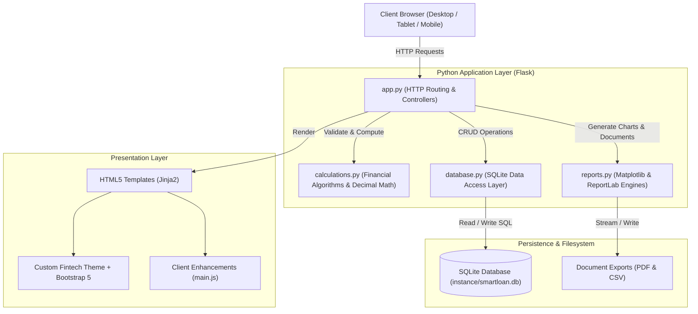
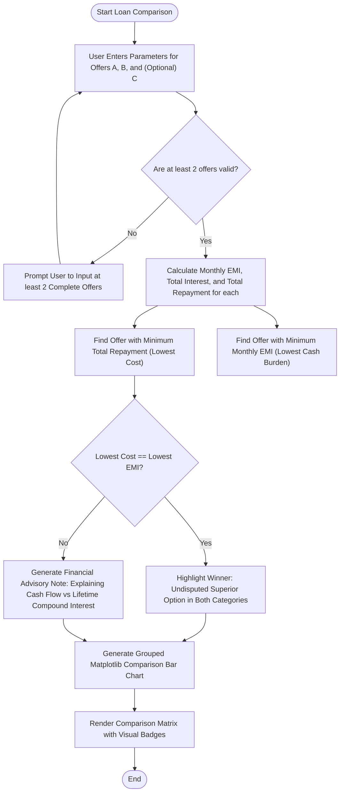

# SmartLoan: System Flowcharts & Architecture

This document contains visual diagrams illustrating user workflows, system data flow, and calculation logic.

---

## 1. High-Level Application Architecture



---

## 2. EMI Calculation & Amortization Lifecycle Flowchart

```mermaid
flowchart TD
    Start(["Start Calculation"]) --> InputForm["User Enters Loan Amount (P), Rate (R), Tenure (N), Unit, Category"]
    InputForm --> Validate{"Input Validation & Sanitization"}
    
    Validate -->|Invalid (P < 1K, R < 0, N <= 0)| ShowError["Flash Descriptive Error Message & Reload Form"]
    ShowError --> InputForm
    
    Validate -->|Valid Parameters| CheckPromo{"Is Annual Interest Rate (R) == 0%?"}
    
    CheckPromo -->|Yes: Promo Loan| ZeroEMI["Calculate EMI = P / N <br/> Total Interest = ₹0.00"]
    CheckPromo -->|No: Standard Compounding| StandardEMI["Compute Monthly Rate: r = (R / 12) / 100 <br/> EMI = P × r × (1+r)^N / ((1+r)^N - 1)"]
    
    ZeroEMI --> LoopInit["Initialize Month-by-Month Loop (Month = 1 to N)"]
    StandardEMI --> LoopInit
    
    LoopInit --> MonthIter{"Month == N (Final Month)?"}
    
    MonthIter -->|No: Normal Month| RegularMonth["Interest = Opening × r <br/> Principal Paid = EMI - Interest <br/> Closing = Opening - Principal Paid"]
    MonthIter -->|Yes: Final Month Adjustment| FinalMonth["Interest = Opening × r <br/> Principal Paid = Opening Balance <br/> EMI = Principal Paid + Interest <br/> Closing = ₹0.00 Exactly"]
    
    RegularMonth --> CheckDone{"All Months Completed?"}
    FinalMonth --> SaveDB[("Insert Calculation Record into SQLite Database")]
    
    CheckDone -->|No| NextMonth["Opening = Previous Closing <br/> Month = Month + 1"] --> MonthIter
    CheckDone -->|Yes| SaveDB
    
    SaveDB --> Matplotlib["Generate Matplotlib Donut Chart (Base64)"]
    Matplotlib --> Dashboard["Render Visual Results Dashboard with 4 KPI Cards"]
    
    Dashboard --> UserAction{"User Action"}
    UserAction -->|View Table| AmortView["Paginated Amortization Table"]
    UserAction -->|Export PDF| PDFGen["ReportLab Compiles Branded PDF Report"]
    UserAction -->|Export CSV| CSVGen["Stream CSV Schedule via Python csv Module"]
    UserAction -->|Compare| CompTool["Launch Multi-Offer Loan Comparator"]
    
    PDFGen --> End(["End"])
    CSVGen --> End
    AmortView --> End
    CompTool --> End
```

---

## 3. Multi-Loan Comparison Flowchart


